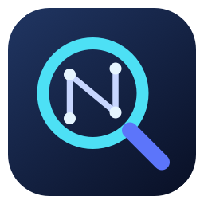

<p align="center"></p>

<h1 align="center">NeuralSpotlight</h1>

<p align="center"><b>Find the thought. Open the file.</b><br>
Local search for apps, files, and the moments you remember.</p>

NeuralSpotlight combines macOS Spotlight with local multimodal embeddings. It prioritizes recently used rich
content, runs EmbeddingGemma 2 through Core ML, and uses USearch for large vector indexes.
Apple silicon and macOS 15 or newer are required for the native app.

This is an independently branded derivative of [DigUp](https://github.com/ARahim3/DigUp).
The original MIT license and third-party notices are retained. This build does not use DigUp's update feed.
Internal Swift module and helper names remain compatible with the existing codebase.

## What you can find

- "zebra in a video" opens the clip at the moment the zebra shows up
- "where they talk about sleep" jumps to that minute of a podcast
- "the clause about pets in the lease" shows the PDF page, with the words marked
- "a dog on the beach" finds the photo, and "payment declined error" the screenshot
- a search in English can find a PDF written in Bengali, Arabic or any of the model's 100+ languages, and the other
  way around
- "code: retry a failed call with backoff" finds the function in your projects, if you turn on code search

Exact words count too. Invoice numbers, error codes and names are matched as written, in file names, document text
and the text inside screenshots, so a search gets both the meaning and the exact string.

The native Mac app also finds applications, folders, and files by name, including formats without a content
reader, such as ZIP archives. File names and system-indexed text come from Spotlight within your chosen folders, with your
folder and extension exclusions applied; Spotlight-excluded or not-yet-indexed files may be missing. Applications
in `/Applications`, `/System/Applications`, and `~/Applications` are searchable even without chosen folders or a
downloaded model. Press Return to open a file or launch an app. The application catalog refreshes on search at most
once a minute. These results do not need embeddings; `code:` continues to search only the separate code index.

The native app prioritizes rich files used in the last 30 days: opening or explicitly using Quick Look in NeuralSpotlight,
and Finder/other-app use reported by Spotlight. Only selected folders count. Apps that do not update the system's
last-used metadata may not be detected. It retains each file's latest use, not a full browsing history. Completed
files are not embedded again just because you open them. Remaining eligible files follow as background work.

The native app uses Core ML for text, image and audio embeddings on Apple silicon with macOS 15 or newer.
Core ML may use the Neural Engine, GPU and CPU and decides the placement of each operation; the app cannot force
a priority order between them. Video keeps its frame and soundtrack extraction. See
[the runtime and indexing notes](docs/search-and-indexing-design.md).

## Private

Search and indexing run on your Mac. Model assets download once; no account or telemetry is required.
This local build has no update feed configured and never downloads upstream application releases.

## Install

1. Run `./build.sh` to produce `build.noindex/NeuralSpotlight.app`.
2. Copy the app to `/Applications/NeuralSpotlight.app` and open it.
3. Choose your folders and shortcut in Settings. The default shortcut is **⇧⌘Space**.

An existing DigUp installation's selected folders, shortcut, and indexing preferences are imported once.
Its existing `~/Library/Application Support/DigUp` directory is reused in place so models and indexes are not
copied or rebuilt. Fresh installations use `~/Library/Application Support/NeuralSpotlight`.
The main and code databases serve different corpora and must both be retained.

## Using it

| Key | What it does |
|---|---|
| ⇧⌘Space | Opens the search panel from any app (you can change it in Settings) |
| ↓ ↑ | Moves through the results |
| ↩ | Opens the result: videos and recordings at the moment, PDFs with your words in Preview's search, code in your editor at the line |
| Space | Quick Look, at the page or moment (once you've moved to a result) |
| ⌘↩ | Shows it in Finder |
| ⌘C | Copies the file, to paste anywhere |
| ⌘O | The same search in a bigger window, with a picture grid and filters |

NeuralSpotlight lives in the menu bar, where you can see how indexing is going, pause it, or open Settings. The first time a
video opens at its moment, macOS asks whether NeuralSpotlight may control QuickTime Player; that's how it jumps there.

## What it reads

Only the folders you choose:

- pictures and screenshots (HEIC, JPEG, PNG, RAW, WebP and more), by what they show, and screenshots by their text too
- PDFs, page by page, scans included. A long one gets its first 30 pages first; recently used PDFs finish before
  ordinary background work (up to 5,000 pages a file)
- ordinary documents (txt, md, rtf, doc, docx, odt, html): the native app searches Spotlight's names and text without
  creating embeddings. Repo documentation in explicitly selected code folders remains part of code search
- audio of any length: NeuralSpotlight extracts overlapping 30-second windows, encodes every 10-second piece with Core ML,
  and combines those pieces into a searchable window; a match points to its moment
- video of any length: a frame every few seconds, one per shot, plus the soundtrack the same way as audio

Outside the folders you pick for code search, it never reads code, and inside a code project (a folder with `.git`,
`package.json` and the like) it reads only screenshots. It never reads keys, certificates, password files, hidden
folders like `~/.ssh`, app bundles or caches. It skips folders that look like datasets, and never downloads iCloud
files that only live in the cloud. You can skip more folders or file types in Settings. NeuralSpotlight only reads your files;
it never changes, moves or uploads them.

The first pass takes a few minutes for a few hundred files and can take an hour for a big Downloads folder. That
happens once, on battery too unless you tell it to wait for a charger, and it pauses in Low Power Mode. All semantic
indexing, including recently opened and newly added files, follows the power and scheduled-hours settings.
Spotlight results remain available while embedding waits; their freshness depends on the system index.

## Code

EmbeddingGemma 2 reads code too, so NeuralSpotlight can search your projects. Code search is off until you turn it on, in
Settings → Code or during setup, for the folders you pick. Each repo shows how long reading it takes and how much room
its index needs. Then start a search with `code:` and say what the code does, or type a name that's in it:

- "code: retry a failed call with backoff" finds the function, whatever it's called
- "code: refreshAccessToken" goes to the line that defines it, not the places that call it
- "code: plot how many examples each class has" finds the notebook cell

Results open in your editor at the line: Zed, VS Code, Cursor, Xcode, Sublime Text, JetBrains IDEs and a few more
(pick one in Settings). Code has an index of its own and never shows up in other searches. NeuralSpotlight reads source files,
notebooks (without their outputs) and a repo's own docs. It skips what git ignores, vendored and generated code, data
files, and anything that looks like a key or a password. While you're working on code, the index catches up a minute
after things go quiet.

Indexing time depends on the project size and the device. Estimates improve as indexing measures this Mac.

## How it works

```
your folders ─► Spotlight names and text ─► immediate results (no model)
rich files   ─► recent-use priority ─► readers (ImageIO, PDFKit, AVFoundation, Vision)
             ─► Core ML text, image and audio models (ANE / GPU / CPU chosen by Core ML)
             ─► one SQLite file: a vector for every picture, page, passage, video frame and 30 s of sound,
                plus a keyword index (code search keeps a second one, for code)
your words   ─► after a 120 ms typing pause, the text encoder ─► USearch HNSW / exact + keyword matches
```

NeuralSpotlight uses [FluidInference's pinned Core ML conversions](https://huggingface.co/FluidInference/embeddinggemma-2-coreml)
for every modality. Each vector has 768 dimensions. Long text chunks are split into token windows and their normalized
embeddings are combined; PDF pages, code stretches and media timestamps remain separate searchable segments.
Exact-word matches get a boost, because no embedding holds an invoice number exactly. SQLite stores vectors and
metadata; USearch builds a disposable HNSW cache for larger collections. Small or narrow searches use exact scoring.
The ANN path reranks candidates and uses an independent calibration sample rather than treating its top results as
the whole collection. The current synthetic benchmark did not show an ANN speed advantage at 50,000 segments.

The app prepares the common 128-token query model in the background at startup once its text assets are available.
Opening search prepares it again if it was released after an idle period. Longer queries use a 512-token shape;
indexing chooses among 32/48/64/128/256/512-token shapes. Verified-file receipts avoid hashing unchanged assets on
every helper restart, and compiled model packages are reused. Apple's first device specialization can still take
time; warm-up does not guarantee an immediate first semantic result. Names and Spotlight results remain independent.

The index records its model and preprocessing identity. Moving from an older runtime to the all-Core-ML runtime
requires rebuilding semantic vectors. The replacement runtime must load and validate successfully before the app
clears the previous derived index; failure leaves the old index on disk. Names and activity records survive the
rebuild. An incompatible query encoder never searches old vectors, so semantic coverage grows again as indexing
finishes. This is not a staged, atomic swap between two complete indexes.

## Build from source

You'll need Xcode 26 and git. If `xcode-select -p` shows the Command Line Tools,
switch to Xcode first (`sudo xcode-select -s /Applications/Xcode.app`): they lack the SwiftUI and Swift Testing
macros the build needs.

```sh
git clone https://github.com/Dongyeongkim/NeuralSpotlight && cd NeuralSpotlight
swift build -c release && swift test
./build.sh                        # → build.noindex/NeuralSpotlight.app
```

There's also a command-line tool, `.build/release/digup`, that indexes, searches and runs the evals from the terminal
(`digup --help`). `scripts/make-testbed.sh` builds a folder of test files to try it on (it needs ffmpeg), and `evals/`
holds the queries ranking changes are measured with.
The CLI retains its existing document policy unless `--rich-content-only` is supplied. `index-service --recent-first`
uses activity recorded by the native app; the CLI does not monitor Finder on its own.

Use `digup download-model --backend coreml --to .dev/models` to install the pinned Core ML assets, then set
`DIGUP_MODELS="$PWD/.dev/models"` when running the CLI. `--backend auto` and `--backend coreml` both select the native
Core ML runtime; missing assets never select a different inference engine. `DIGUP_COREML_MODELS` can point directly
to the `CoreML` subfolder. `--shot-tokens` accepts 70, 140 or 280 for the bundled vision graph.

The portable CLI retains extraction, storage, search and the external-worker protocol. Linux and Windows require a
separately provisioned `DIGUP_WORKER_DIR`; they do not bundle a native embedding runtime. The repository's optional
`worker/` implementation uses MLX and is not a portable model implementation. Manage Python workers with `uv`.

## FAQ

**How is this different from Spotlight?** Spotlight finds files by their names, text and metadata. NeuralSpotlight also finds
them by what they show or say, and takes you to the page or moment. The two work fine side by side.

**Windows or Linux?** Portable builds require an explicitly configured external embedding worker. Core ML runs only on supported Macs.

**Why is the model download about 1.48 GB?** The 12 pinned assets total 1,481,900,463 bytes: text and tokenizer
584,745,430 bytes, vision 309,277,919 bytes, and audio 587,877,114 bytes. Compiled model and device caches use additional space.

**Will it slow my Mac down?** The first pass does the most work. Later passes handle new or changed files. Indexing
runs in a helper that exits when its work is done. The query helper prepares in the background and exits after its idle timeout.

**Which languages?** The model knows more than 100, and NeuralSpotlight searches in all of them, across languages too. The evals
cover only English, Bengali and Arabic because those are the languages of the files NeuralSpotlight was tested on, and Google
notes that the model isn't equally strong in every language. Two limits apply to exact words, not to meaning: inside
screenshots they're read by Apple's text recognition, which knows about 25 languages, and languages written without
spaces, like Chinese, Japanese and Thai, aren't split into words.

**How do I remove it?** Quit and remove `/Applications/NeuralSpotlight.app`. Storage settings show the active
index location. Fresh installations use `~/Library/Application Support/NeuralSpotlight`; migrated installations
reuse `~/Library/Application Support/DigUp`. Remove those data only if you no longer need the models and indexes.
Preferences are stored in `~/Library/Preferences/com.neuralspotlight.app.plist`.

## Thanks

NeuralSpotlight is built on [EmbeddingGemma 2](https://huggingface.co/google/embeddinggemma-2) by Google DeepMind (Apache 2.0),
[FluidInference's Core ML conversion and preprocessing](https://github.com/FluidInference/FluidUse) (Apache 2.0),
[USearch](https://github.com/unum-cloud/USearch) (Apache 2.0), and [Sparkle](https://sparkle-project.org) (MIT). Their
license notices ship inside the app, in `NeuralSpotlight.app/Contents/Resources/Acknowledgements.txt`.

NeuralSpotlight isn't affiliated with Google or Apple. Gemma is a trademark of Google LLC; Mac and Spotlight are trademarks of
Apple Inc.

## License

MIT
